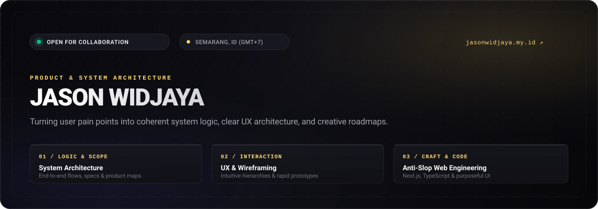
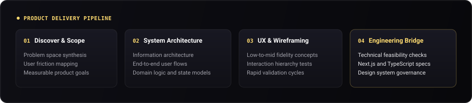

<div align="center">

  <!-- Header Banner -->
  

  <br/><br/>

  <!-- Interactive Quick Status Badges -->
  <p align="center">
    <a href="https://www.jasonwidjaya.my.id/">
      
    </a>
    <a href="mailto:jason.widjaya123@gmail.com">
      
    </a>
    <a href="https://github.com/VJasonW">
      
    </a>
  </p>

</div>

<br/>

### ✦ Executive Summary

> *"Turning user pain points into coherent system logic, clear UX architecture, and creative roadmaps."*

I am a **Product Manager & System Architect** based in Semarang, Indonesia. I specialize in the intersection of digital product strategy, information architecture, and technical feasibility. Rather than building feature bloat or generic templated interfaces, I focus on the structural **why** and the **how**—aligning engineering capabilities with intuitive user outcomes.

<br/>

<!-- System Architecture Visual Flow -->
<div align="center">
  
</div>

<br/>

### ❖ Strategic Pillars

<table>
  <tr>
    <td width="50%" valign="top">
      <h4>🏗️ Product &amp; System Architecture</h4>
      <p>Defining domain models, system states, and end-to-end user flows. Deconstructing ambiguous problems into clear, modular functional specifications.</p>
    </td>
    <td width="50%" valign="top">
      <h4>🧭 UX Strategy &amp; Wireframing</h4>
      <p>Translating conceptual logic into structural wireframes and interaction hierarchies. Prioritizing information density and friction reduction before visual polish.</p>
    </td>
  </tr>
  <tr>
    <td width="50%" valign="top">
      <h4>⚡ Anti-Slop &amp; Design Taste</h4>
      <p>Championing deliberate, non-templated digital products. Enforcing strict typography, purposeful whitespace, and authentic motion dynamics over generic AI clichés.</p>
    </td>
    <td width="50%" valign="top">
      <h4>🌉 Cross-Functional Alignment</h4>
      <p>Bridging design vision with engineering reality. Ensuring product roadmaps are technically viable, testable, and aligned with core business metrics.</p>
    </td>
  </tr>
</table>

<br/>

### 🛠️ Core Toolkit &amp; Technologies

```
PRODUCT & STRATEGY  │  Figma  •  Linear  •  Notion  •  Information Architecture  •  User Mapping
ENGINEERING STACK   │  TypeScript  •  JavaScript  •  Next.js  •  React  •  Tailwind CSS  •  Node.js
SYSTEM QUALITY      │  Anti-Slop Directives  •  RESTful APIs  •  Git Architecture  •  UI Auditing
```

<br/>

### 📈 Activity &amp; Momentum

<div align="center">
  <a href="https://github.com/VJasonW">
    
  </a>
</div>

<br/>

### 📂 Curated Repositories &amp; Initiatives

- ⚡ **[`anti-slop`](https://github.com/VJasonW/anti-slop)**  
  *Systematic rules and heuristics for AI coding agents to eliminate generic boilerplate, uninspired layouts, and UI design slop.*

- 🏛️ **[`Project-Batik-Indonesia`](https://github.com/VJasonW/Project-Batik-Indonesia)**  
  *Modern TypeScript web application dedicated to archiving and showcasing Indonesian batik cultural heritage with clean interaction patterns.*

- 🎯 **[`Pemilihan-Tempat-Magang-DSS`](https://github.com/VJasonW/Pemilihan-Tempat-Magang-DSS-)**  
  *Decision Support System (DSS) engineered to compute and match student internship placements based on weighted criteria.*

- 🏆 **[`FICPACT`](https://github.com/VJasonW/FICPACT)**  
  *Official event and tournament platform architecture for the FICPACT CUP competition.*

<br/>

### ✦ Let's Connect

- **Portfolio & Case Studies**: [jasonwidjaya.my.id](https://www.jasonwidjaya.my.id/)
- **GitHub**: [@VJasonW](https://github.com/VJasonW)
- **Email**: [jason.widjaya123@gmail.com](mailto:jason.widjaya123@gmail.com)
- **Location**: Semarang, Central Java, Indonesia

<br/>

<div align="center">
  <sub>Engineered with precision &amp; high taste. No boilerplate slop.</sub>
</div>
